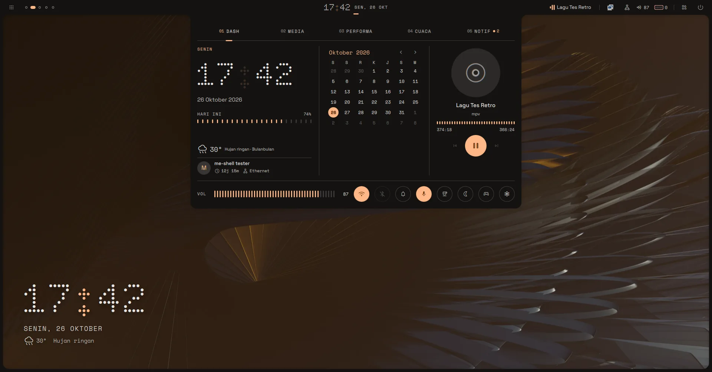
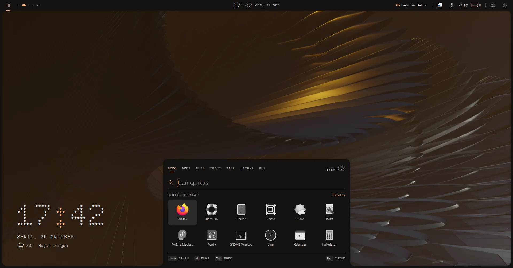
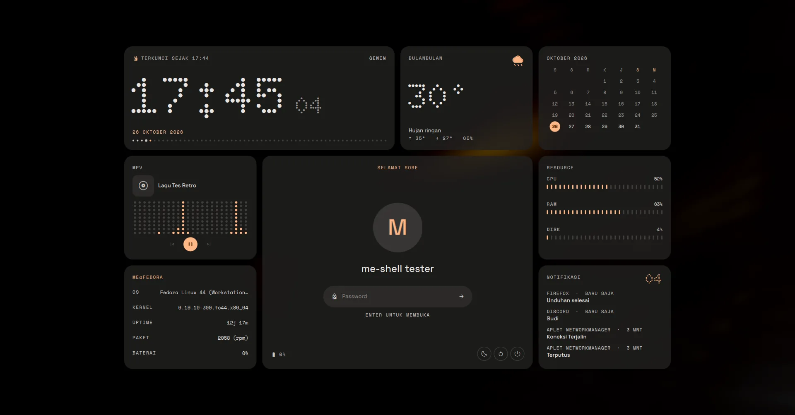
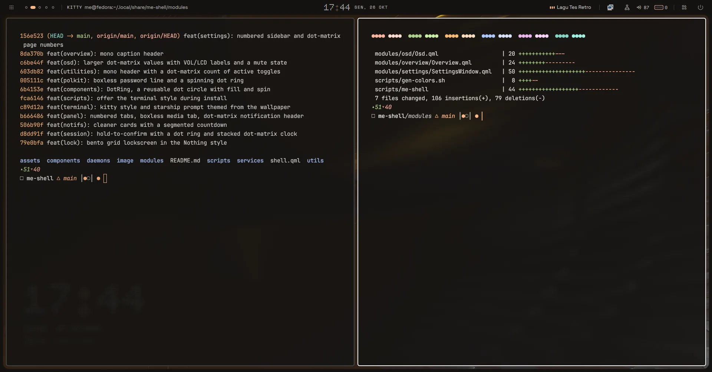
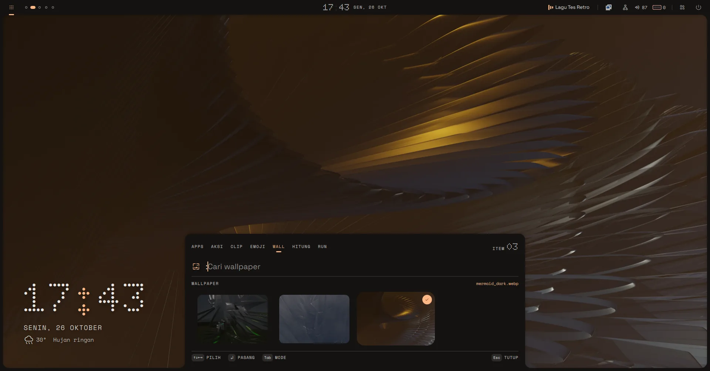
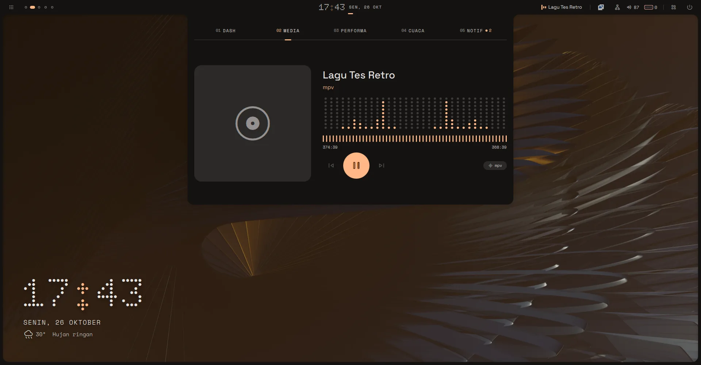
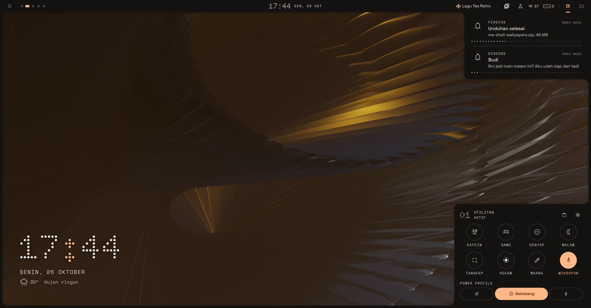
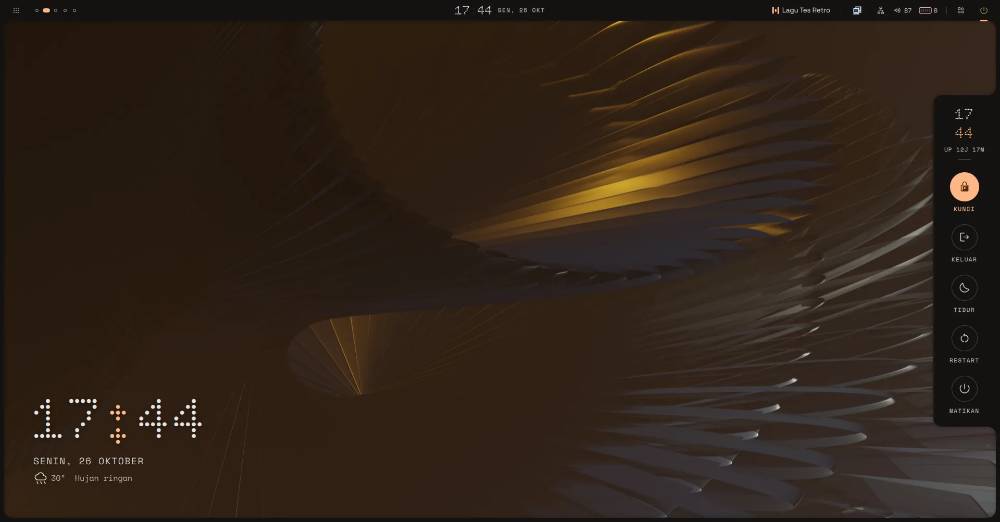
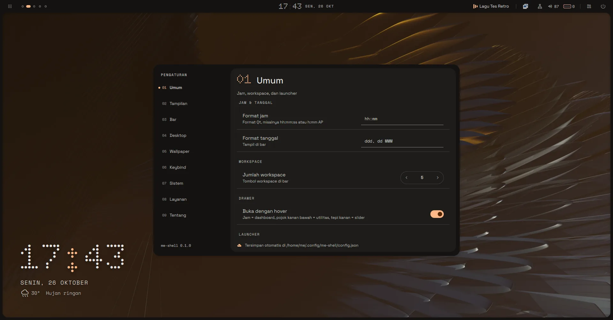

<div align="center">
There is some issue with the hyptland in this version so ill try fix it 
<div></div>


<div align="center">

# me-shell

A Hyprland desktop shell written in [Quickshell](https://quickshell.org), dressed in the monochrome look of Nothing and Teenage Engineering.

[](https://github.com/Adomancer/me-shell/stargazers)
[](https://github.com/Adomancer/me-shell/commits/main)
[](https://github.com/Adomancer/me-shell)
[](LICENSE)

[Screenshots](#screenshots) · [Features](#features) · [Install](#install) · [Keybinds](#keybinds) · [Configuration](#configuration) · [Credits](#credits) · [License](#license)



</div>

## About

me-shell replaces the bar, notification daemon, launcher, lockscreen, idle daemon, and polkit agent of a Hyprland setup with one Quickshell config.

The structure and motion come from [Caelestia](https://github.com/caelestia-dots/shell): the bar and every panel are drawn as one shape with the screen frame, and panels grow out of the screen edge on springs. The look is my own take on Nothing and Teenage Engineering:

- no boxes, just spacing and thin dividers
- big numbers in a dot-matrix font (Doto)
- segmented sliders and dot rings instead of plain bars
- one accent color, picked from your wallpaper

> [!NOTE]
> Tested on Fedora 44 (Hyprland 0.56, Quickshell 0.3) in a VM. Real laptops, multi-monitor, and Arch have not been tested yet, so expect rough edges. The interface text is in Indonesian for now.

## Screenshots

<table>
  <tr>
    <td></td>
    <td></td>
  </tr>
  <tr>
    <td align="center">Launcher with mode tabs and a grid of your most used apps</td>
    <td align="center">Bento lockscreen</td>
  </tr>
  <tr>
    <td></td>
    <td></td>
  </tr>
  <tr>
    <td align="center">kitty and starship, themed from the wallpaper</td>
    <td align="center">Wallpaper picker</td>
  </tr>
  <tr>
    <td></td>
    <td></td>
  </tr>
  <tr>
    <td align="center">Media tab with a dot-matrix visualizer</td>
    <td align="center">Notifications and the utilities panel</td>
  </tr>
  <tr>
    <td></td>
    <td></td>
  </tr>
  <tr>
    <td align="center">Power menu with hold-to-confirm</td>
    <td align="center">Settings</td>
  </tr>
</table>

## Features

**Bar and panels**

- Bar with workspaces, the active window, now playing, clock, tray, and status icons
- Hover popouts under the bar icons: Wi-Fi (with a password field), Bluetooth pairing, audio output and per-app volume, battery and power profiles, a live window preview, and media controls
- Control panel that drops from the clock, with five tabs: dashboard, media with a cava visualizer, performance, weather, and notifications grouped by app
- Utilities panel in the bottom right corner: caffeine, game mode, do not disturb, night light, screenshot, screen recording, color picker, mic, and power profiles
- Workspace overview with live window previews; drag a window onto another workspace to move it

**Launcher**

- Opens on a grid of your most used apps; start typing to search
- `Tab` or a prefix switches modes: `/` shell actions, `;` clipboard history, `.` emoji, `:` wallpapers, `=` calculator, `>` run a command
- Typing a formula in app mode shows the answer right away; calculator results are drawn in big dot-matrix digits
- App icons are monochrome until selected (can be turned off)

**Lockscreen and session**

- Bento grid lockscreen: clock with a seconds dot row, weather, calendar, media, system info, resources, and notifications
- Tiles pop in one by one and fly out when you unlock; optional CRT shader
- Power menu on the right edge: log out, restart, and power off only run after you hold the button until its dot ring fills
- Built-in idle handling (lock, screen off, suspend), so hypridle is not needed
- Built-in polkit agent, so hyprpolkitagent or polkit-gnome are not needed

**Everything else**

- Notifications you can swipe away, with a dot countdown that pauses on hover
- Volume and brightness OSD on the right edge that you can drag directly
- Dot-matrix clock and audio visualizer on the desktop
- Screenshot and screen recording with an area picker: hover a window to pick it, or drag a region
- Wallpaper rendering, with colors generated from it by matugen for the shell, kitty, and the starship prompt
- App usage with daily totals, Monday–Sunday weekly summaries, a seven-day chart, and most-used apps
- A settings window for everything, including keybinds

Some panels also open on hover: rest on the clock for the dashboard, the bottom right corner for utilities, and the right edge for the volume slider. Turn this off in settings if it gets in the way.

## Install

One line, on Arch or Fedora:

```sh
curl -fsSL https://raw.githubusercontent.com/Adomancer/me-shell/main/scripts/install.sh | bash
```

The script asks once before installing packages. Then log in to Hyprland and the shell starts by itself.

<details>
<summary>What the installer does</summary>

- Installs Hyprland (if missing), Quickshell, matugen, kitty, starship, and the rest: grim, wf-recorder, cliphist, hyprpicker, hyprsunset, cava, and friends. On Fedora, Hyprland, Quickshell, and starship come from COPR.
- Downloads Material Symbols, Rubik, Doto, Space Grotesk, and Space Mono to `~/.local/share/fonts/me-shell`.
- Clones the repo to `~/.local/share/me-shell` and adds the `me-shell` command to `~/.local/bin`.
- Creates `~/.config/me-shell/hypr/` and adds one `source` line to your `hyprland.conf`, with a backup. If you have no `hyprland.conf`, it writes a minimal one.
- Adds the me-shell style to `kitty.conf` and turns on starship in your `.bashrc`, `.zshrc`, or `config.fish`, with backups.
- Offers to disable Waybar, swaync, mako, dunst, hypridle, and other polkit agents if it finds them in your config, since they clash.

</details>

If you install from a live USB, run `passwd` first. The live user has no password, so the lockscreen cannot be unlocked otherwise.

```
me-shell update      pull the latest version and restart
me-shell restart     restart the shell
me-shell log         run in the terminal and save a log (for bug reports)
me-shell uninstall   detach from Hyprland and restore what was disabled
```

## Keybinds

The defaults follow [JaKooLit](https://github.com/JaKooLit/Hyprland-Dots). Hyprland files are split like this:

```
~/.config/me-shell/hypr/
  me-shell.conf    the file your hyprland.conf sources
  keybinds.conf    shell keybinds, written from the settings window
  user.conf        yours, never overwritten
```

<details open>
<summary>Default keybinds</summary>

| Keys | Action |
|---|---|
| `SUPER + D` | Launcher |
| `SUPER + W` | Wallpapers |
| `SUPER + V` | Clipboard history |
| `SUPER + .` | Emoji |
| `SUPER + SHIFT + E` | Control panel |
| `SUPER + SHIFT + N` | Notifications |
| `SUPER + A` | Utilities |
| `SUPER + Tab` | Workspace overview |
| `SUPER + I` | Settings |
| `SUPER + SHIFT + S` | Screenshot a window or area |
| `Print` | Screenshot the whole screen |
| `SUPER + SHIFT + R` | Start or stop recording |
| `SUPER + SHIFT + C` | Pick a color from the screen |
| `CTRL + ALT + P` | Power menu |
| `CTRL + ALT + L` | Lock |

</details>

Volume, mic, media, and brightness keys work out of the box. Every bind can be changed in Settings, Keybind page, then "Terapkan keybind" (apply). Coming from JaKooLit, remove the old binds that call rofi, wlogout, swaync, and the volume, media, screenshot, and clipboard scripts so nothing fires twice.

Screenshots go to `~/Pictures/Screenshots` and are copied to the clipboard; recordings go to `~/Videos/Recordings`.

> [!IMPORTANT]
> Keep `allow_session_lock_restore = true` in `me-shell.conf`. If the shell ever crashes while the screen is locked, that option is what lets the lockscreen come back.

## Configuration

The easiest way is the settings window (`SUPER + I`). Changes are saved to `~/.config/me-shell/config.json` and apply right away. You can also edit the file by hand:

```json
{
  "clockFormat": "hh:mm",
  "workspaces": 5,
  "wallpaperDir": "~/Pictures/Wallpapers",
  "renderWallpaper": true,
  "launcherMonoIcons": true,
  "crtShader": false,
  "weatherLocation": "Jakarta"
}
```

Every option is listed in [`utils/Config.qml`](utils/Config.qml).

- The profile picture comes from `~/.face`.
- Weather comes from wttr.in. If `weatherLocation` is empty, it guesses from your IP.
- If swww or hyprpaper already draws your wallpaper, set `renderWallpaper` to `false`.
- The lockscreen CRT shader needs `scripts/build-shaders.sh` once before `crtShader` works.
- Your own kitty settings go below the `include` line in `kitty.conf`, so they win over the me-shell style.

### App usage

Open the control panel (`SUPER + SHIFT + E`) and select **Waktu**, or run:

```sh
qs -c me-shell ipc call drawers panel usage
```

Usage counts the globally focused application, not background processes or every visible window. The period selector offers today, this week, last week, this month (**Bulan ini**), and last month (**Bulan lalu**), with previous-period totals and ranked app/category lists. Today's chart covers the trailing seven days; weekly charts run Monday–Sunday. History begins when tracking first runs; missing days are shown as zero, not reconstructed.

Monthly views show the month's total, average per calendar day (including zero-usage days), a bar for each date, and app/category totals. Hover a daily bar to see its date and duration; future dates are dimmed. This month includes today, so today's partial usage can still grow. Comparisons use the first N days of both months, where N is the smaller of elapsed days and the previous month's length. For example, March 31 compares March 1–28 with February 1–28 in a non-leap year, while the displayed March total still includes all 31 days. A zero previous total has no percentage baseline rather than an infinite increase. Last month compares against the month before it using the same rule.

Monthly totals use retained history only. Empty days may mean no recorded activity, tracking was off, or history was not yet available; they are not proof the computer was unused. The view warns when retention excludes part of the selected/comparison month. The default 90-day retention covers these month ranges, but cannot recover activity before tracking began or after history was cleared. No CSV or other export is added.

Switch between **Aplikasi** and **Kategori** to see apps or category totals. Categories are detected from installed desktop entries: development, entertainment, communication, productivity, browsing, and other. Each app row has a category selector; choose a category to override detection, or **Otomatis** to reset. Overrides are saved in configuration and immediately reclassify all retained history without changing recorded durations. Unknown/uninstalled apps fall back to other unless overridden. These are app-level categories, not website or document classifications.

Tracking is enabled by default while me-shell is running. It stops while locked, paused, idle (two minutes without input by default), or using a focus-taking shell panel. Existing configured idle thresholds are unchanged. The idle grace period is still counted as active, including the final minute before the system becomes idle, so reported usage can be slightly higher than actual active use. Hover panels do not interrupt tracking. Caffeine never overrides usage idle detection.

**Media-aware tracking is optional and off by default.** Enable **Hitung media aktif** in Settings → Services → Waktu penggunaan to keep counting the focused app past the idle threshold while a matching MPRIS player is playing. Background music from another app does not keep the focused app active. Pausing/stopping playback, switching to a different app, locking, pausing tracking, disabling tracking, or exclusions still stop idle-time counting. A player must expose a matching desktop-entry ID; missing or unresolvable IDs fall back to normal idle handling. Matching is app-level, so this cannot distinguish browser tabs or separate windows of the same app. Even matching playback stops bypassing idle after 60 minutes without user input; new input resets that limit. No track metadata is stored.

In **Settings → Services → Waktu penggunaan**, you can disable tracking, change the idle threshold, exclude comma-separated application IDs, set retention (21–365 days, default 90), or clear all history with confirmation. Exclusions affect future tracking, not existing history. The Usage tab's pause lasts until resumed or the shell process restarts; it survives hot reloads.

Only app IDs, display names, icons, and daily accumulated durations are saved in `~/.local/state/me-shell/usage.json` (or the corresponding `XDG_STATE_HOME` directory). No window titles, URLs, document names, or event timeline are recorded or uploaded.

Accounting uses Quickshell's monotonic `ElapsedTimer`, checkpoints every five seconds and on focus/state transitions, and saves atomically every 30 seconds and when tracking stops. Long timer gaps and clock corrections are discarded rather than backfilled. Sleep and shell downtime are not reconstructed; reloads may lose the final five seconds, and an abrupt stop may lose roughly 30 seconds of unsaved usage with healthy storage. Invalid history is left untouched until explicitly cleared. This is a focused-app estimate, not a complete measure of human attention.

Configuration keys: `usageEnabled`, `usageIdleMinutes`, `usageRetentionDays`, `usageExcludedApps` (an array of app IDs, e.g. `["firefox", "kitty"]`), `usageMediaAware` (default `false`), and `usageAppCategories` (an app-ID-to-category object).

For example:

```json
{
  "usageMediaAware": true,
  "usageAppCategories": {
    "dev.zed.Zed": "development",
    "firefox": "productivity"
  }
}
```

Supported category IDs: `development`, `entertainment`, `communication`, `productivity`, `browsing`, and `other`. Remove an override or select **Otomatis** to restore detection. Node is only needed to run the developer tests, not to use tracking.

## Development

Run straight from the repo with `qs -p ~/me-shell`. Every save reloads the shell and errors show up in the terminal. All colors, sizes, and animation timings live in [`utils/Appearance.qml`](utils/Appearance.qml).

Usage accounting and tracker regression tests can run without Quickshell using Node.js:

```sh
node --test tests/*.test.cjs
TZ=America/New_York node --test tests/*.test.cjs
```

The tests cover calendar boundaries, DST, retention, summaries (including leap years and matched monthly comparisons), state transitions, persistence, category detection/overrides, and focused-player media-aware idle handling. QML signals, compositor behavior, and rendering still need a live Hyprland session.

Testing in VirtualBox, Qt can crash on the virtual GPU driver. Add `env = LIBGL_ALWAYS_SOFTWARE,1` and `env = MESA_LOADER_DRIVER_OVERRIDE,llvmpipe` to `~/.config/me-shell/hypr/user.conf`. Animations look choppier because the CPU draws them; real hardware is smooth.

## Credits

me-shell is written from scratch, but a lot of it is borrowed from people who did it first.

**Projects this is based on**

- [caelestia-dots/shell](https://github.com/caelestia-dots/shell): the drawer structure (bar, panels, and screen frame drawn as one shape), the spring animations, the hover popouts under the bar, and the bento lockscreen layout
- [caelestia-dots/caelestia](https://github.com/caelestia-dots/caelestia): the starship prompt is adapted from its `starship.toml`, and the kitty look (padding, translucency, thin beam cursor) follows its foot config
- [end-4/dots-hyprland](https://github.com/end-4/dots-hyprland): the floating settings window with a category sidebar, and proof of how far a Quickshell setup can go
- [JaKooLit/Hyprland-Dots](https://github.com/JaKooLit/Hyprland-Dots): the default keybinds and the split `me-shell.conf` / `keybinds.conf` / `user.conf` layout
- [Material Design 3](https://m3.material.io): the easing curves and the color roles behind `Appearance.qml`
- Nothing and Teenage Engineering: the visual language (dot-matrix numbers, numbered labels, segmented controls). me-shell is not affiliated with either company.

**Built with**

- [Hyprland](https://hyprland.org) and [Quickshell](https://quickshell.org)
- [matugen](https://github.com/InioX/matugen) for wallpaper colors
- [kitty](https://sw.kovidgoyal.net/kitty) and [starship](https://starship.rs) for the terminal
- [cava](https://github.com/karlstav/cava), [cliphist](https://github.com/sentriz/cliphist), [grim](https://sr.ht/~emersion/grim), [wf-recorder](https://github.com/ammen99/wf-recorder), [hyprpicker](https://github.com/hyprwm/hyprpicker), and [hyprsunset](https://github.com/hyprwm/hyprsunset)
- [wttr.in](https://wttr.in) for weather
- Emoji names from the [Unicode emoji data](https://unicode.org/emoji)

**Fonts**

- [Doto](https://fonts.google.com/specimen/Doto), [Space Grotesk](https://fonts.google.com/specimen/Space+Grotesk), [Space Mono](https://fonts.google.com/specimen/Space+Mono), [Rubik](https://fonts.google.com/specimen/Rubik), and [JetBrains Mono](https://www.jetbrains.com/lp/mono), all under the SIL Open Font License
- [Material Symbols](https://fonts.google.com/icons) under the Apache License 2.0

## License

[GPL-3.0](LICENSE), the same license as Caelestia, end-4, and JaKooLit, whose work this builds on.
