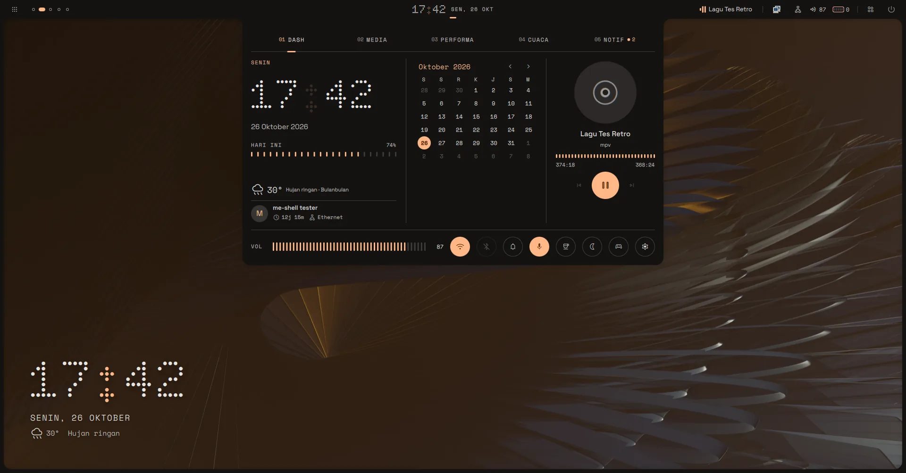
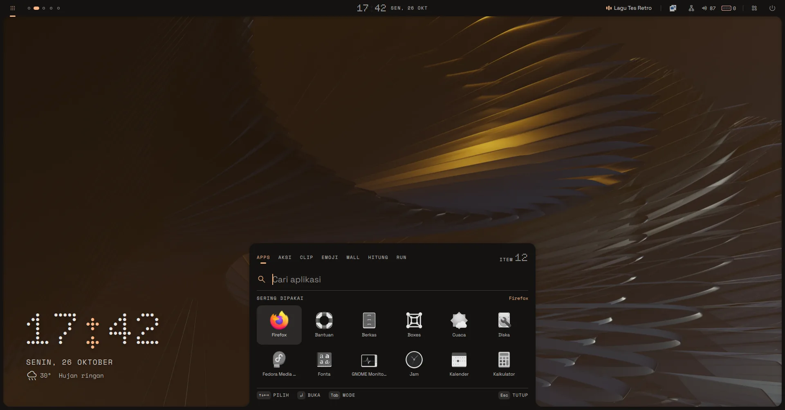
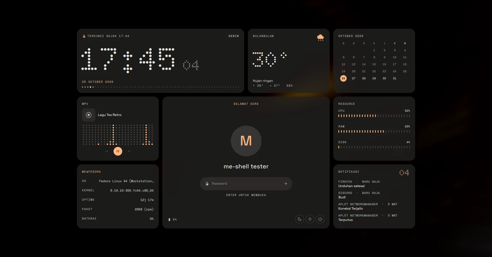
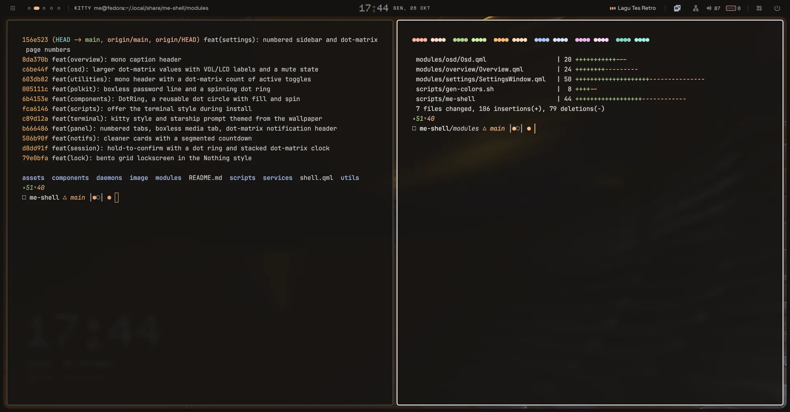
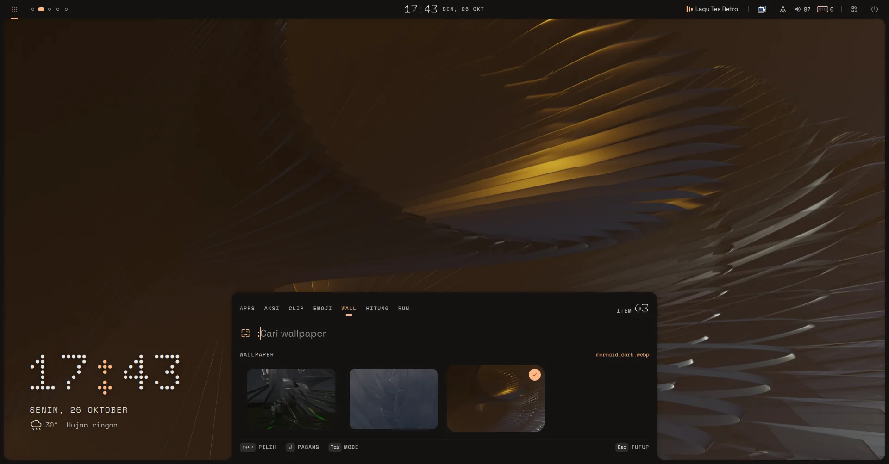
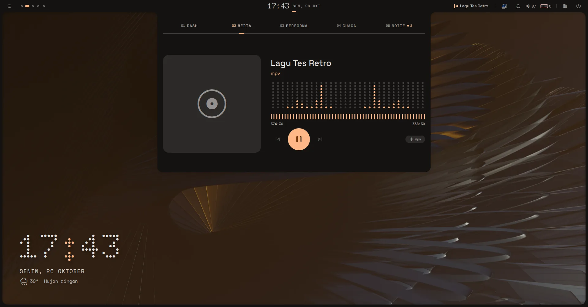
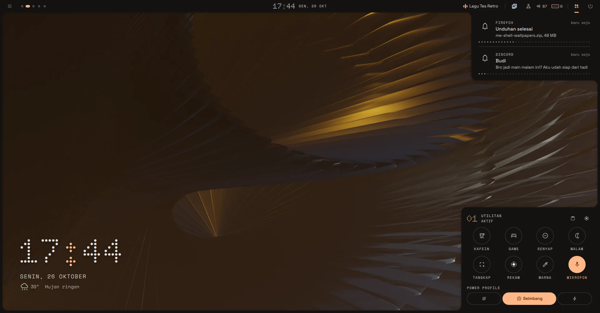
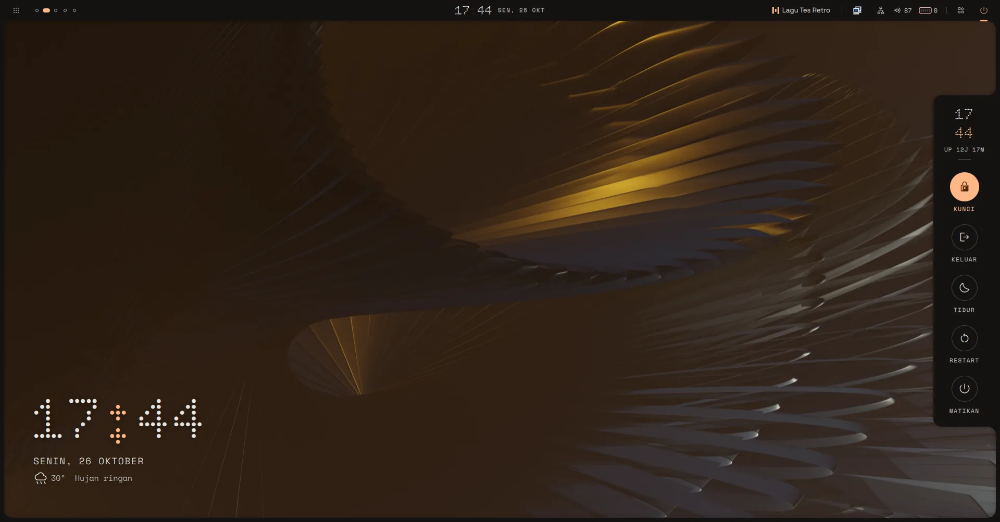
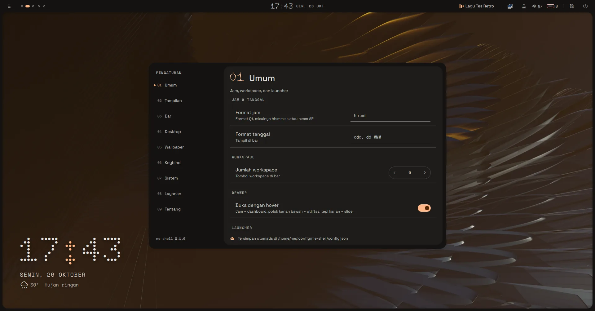

<div align="center">

# me-shell

A Hyprland desktop shell written in [Quickshell](https://quickshell.org), dressed in the monochrome look of Nothing and Teenage Engineering.

[](https://github.com/Adomancer/me-shell/stargazers)
[](https://github.com/Adomancer/me-shell/commits/main)
[](https://github.com/Adomancer/me-shell)

[Screenshots](#screenshots) · [Features](#features) · [Install](#install) · [Keybinds](#keybinds) · [Configuration](#configuration) · [Credits](#credits)



</div>

## About

me-shell replaces the bar, notification daemon, launcher, lockscreen, idle daemon, and polkit agent of a Hyprland setup with one Quickshell config.

The structure and motion come from [Caelestia](https://github.com/caelestia-dots/shell): the bar and every panel are drawn as one shape with the screen frame, and panels grow out of the screen edge on springs. The look is my own take on Nothing and Teenage Engineering:

- no boxes, just spacing and thin dividers
- big numbers in a dot-matrix font (Doto)
- segmented sliders and dot rings instead of plain bars
- one accent color, picked from your wallpaper

> [!NOTE]
> Tested on Fedora 44 (Hyprland 0.56, Quickshell 0.3) in a VM. Real laptops, multi-monitor, and Arch have not been tested yet, so expect rough edges. The interface text is in Indonesian for now.

## Screenshots

<table>
  <tr>
    <td></td>
    <td></td>
  </tr>
  <tr>
    <td align="center">Launcher with mode tabs and a grid of your most used apps</td>
    <td align="center">Bento lockscreen</td>
  </tr>
  <tr>
    <td></td>
    <td></td>
  </tr>
  <tr>
    <td align="center">kitty and starship, themed from the wallpaper</td>
    <td align="center">Wallpaper picker</td>
  </tr>
  <tr>
    <td></td>
    <td></td>
  </tr>
  <tr>
    <td align="center">Media tab with a dot-matrix visualizer</td>
    <td align="center">Notifications and the utilities panel</td>
  </tr>
  <tr>
    <td></td>
    <td></td>
  </tr>
  <tr>
    <td align="center">Power menu with hold-to-confirm</td>
    <td align="center">Settings</td>
  </tr>
</table>

## Features

**Bar and panels**

- Bar with workspaces, the active window, now playing, clock, tray, and status icons
- Hover popouts under the bar icons: Wi-Fi (with a password field), Bluetooth pairing, audio output and per-app volume, battery and power profiles, a live window preview, and media controls
- Control panel that drops from the clock, with five tabs: dashboard, media with a cava visualizer, performance, weather, and notifications grouped by app
- Utilities panel in the bottom right corner: caffeine, game mode, do not disturb, night light, screenshot, screen recording, color picker, mic, and power profiles
- Workspace overview with live window previews; drag a window onto another workspace to move it

**Launcher**

- Opens on a grid of your most used apps; start typing to search
- `Tab` or a prefix switches modes: `/` shell actions, `;` clipboard history, `.` emoji, `:` wallpapers, `=` calculator, `>` run a command
- Typing a formula in app mode shows the answer right away; calculator results are drawn in big dot-matrix digits
- App icons are monochrome until selected (can be turned off)

**Lockscreen and session**

- Bento grid lockscreen: clock with a seconds dot row, weather, calendar, media, system info, resources, and notifications
- Tiles pop in one by one and fly out when you unlock; optional CRT shader
- Power menu on the right edge: log out, restart, and power off only run after you hold the button until its dot ring fills
- Built-in idle handling (lock, screen off, suspend), so hypridle is not needed
- Built-in polkit agent, so hyprpolkitagent or polkit-gnome are not needed

**Everything else**

- Notifications you can swipe away, with a dot countdown that pauses on hover
- Volume and brightness OSD on the right edge that you can drag directly
- Dot-matrix clock and audio visualizer on the desktop
- Screenshot and screen recording with an area picker: hover a window to pick it, or drag a region
- Wallpaper rendering, with colors generated from it by matugen for the shell, kitty, and the starship prompt
- A settings window for everything, including keybinds

Some panels also open on hover: rest on the clock for the dashboard, the bottom right corner for utilities, and the right edge for the volume slider. Turn this off in settings if it gets in the way.

## Install

One line, on Arch or Fedora:

```sh
curl -fsSL https://raw.githubusercontent.com/Adomancer/me-shell/main/scripts/install.sh | bash
```

The script asks once before installing packages. Then log in to Hyprland and the shell starts by itself.

<details>
<summary>What the installer does</summary>

- Installs Hyprland (if missing), Quickshell, matugen, kitty, starship, and the rest: grim, wf-recorder, cliphist, hyprpicker, hyprsunset, cava, and friends. On Fedora, Hyprland, Quickshell, and starship come from COPR.
- Downloads Material Symbols, Rubik, Doto, Space Grotesk, and Space Mono to `~/.local/share/fonts/me-shell`.
- Clones the repo to `~/.local/share/me-shell` and adds the `me-shell` command to `~/.local/bin`.
- Creates `~/.config/me-shell/hypr/` and adds one `source` line to your `hyprland.conf`, with a backup. If you have no `hyprland.conf`, it writes a minimal one.
- Adds the me-shell style to `kitty.conf` and turns on starship in your `.bashrc`, `.zshrc`, or `config.fish`, with backups.
- Offers to disable Waybar, swaync, mako, dunst, hypridle, and other polkit agents if it finds them in your config, since they clash.

</details>

If you install from a live USB, run `passwd` first. The live user has no password, so the lockscreen cannot be unlocked otherwise.

```
me-shell update      pull the latest version and restart
me-shell restart     restart the shell
me-shell log         run in the terminal and save a log (for bug reports)
me-shell uninstall   detach from Hyprland and restore what was disabled
```

## Keybinds

The defaults follow [JaKooLit](https://github.com/JaKooLit/Hyprland-Dots). Hyprland files are split like this:

```
~/.config/me-shell/hypr/
  me-shell.conf    the file your hyprland.conf sources
  keybinds.conf    shell keybinds, written from the settings window
  user.conf        yours, never overwritten
```

<details open>
<summary>Default keybinds</summary>

| Keys | Action |
|---|---|
| `SUPER + D` | Launcher |
| `SUPER + W` | Wallpapers |
| `SUPER + V` | Clipboard history |
| `SUPER + .` | Emoji |
| `SUPER + SHIFT + E` | Control panel |
| `SUPER + SHIFT + N` | Notifications |
| `SUPER + A` | Utilities |
| `SUPER + Tab` | Workspace overview |
| `SUPER + I` | Settings |
| `SUPER + SHIFT + S` | Screenshot a window or area |
| `Print` | Screenshot the whole screen |
| `SUPER + SHIFT + R` | Start or stop recording |
| `SUPER + SHIFT + C` | Pick a color from the screen |
| `CTRL + ALT + P` | Power menu |
| `CTRL + ALT + L` | Lock |

</details>

Volume, mic, media, and brightness keys work out of the box. Every bind can be changed in Settings, Keybind page, then "Terapkan keybind" (apply). Coming from JaKooLit, remove the old binds that call rofi, wlogout, swaync, and the volume, media, screenshot, and clipboard scripts so nothing fires twice.

Screenshots go to `~/Pictures/Screenshots` and are copied to the clipboard; recordings go to `~/Videos/Recordings`.

> [!IMPORTANT]
> Keep `allow_session_lock_restore = true` in `me-shell.conf`. If the shell ever crashes while the screen is locked, that option is what lets the lockscreen come back.

## Configuration

The easiest way is the settings window (`SUPER + I`). Changes are saved to `~/.config/me-shell/config.json` and apply right away. You can also edit the file by hand:

```json
{
  "clockFormat": "hh:mm",
  "workspaces": 5,
  "wallpaperDir": "~/Pictures/Wallpapers",
  "renderWallpaper": true,
  "launcherMonoIcons": true,
  "crtShader": false,
  "weatherLocation": "Jakarta"
}
```

Every option is listed in [`utils/Config.qml`](utils/Config.qml).

- The profile picture comes from `~/.face`.
- Weather comes from wttr.in. If `weatherLocation` is empty, it guesses from your IP.
- If swww or hyprpaper already draws your wallpaper, set `renderWallpaper` to `false`.
- The lockscreen CRT shader needs `scripts/build-shaders.sh` once before `crtShader` works.
- Your own kitty settings go below the `include` line in `kitty.conf`, so they win over the me-shell style.

## Development

Run straight from the repo with `qs -p ~/me-shell`. Every save reloads the shell and errors show up in the terminal. All colors, sizes, and animation timings live in [`utils/Appearance.qml`](utils/Appearance.qml).

Testing in VirtualBox, Qt can crash on the virtual GPU driver. Add `env = LIBGL_ALWAYS_SOFTWARE,1` and `env = MESA_LOADER_DRIVER_OVERRIDE,llvmpipe` to `~/.config/me-shell/hypr/user.conf`. Animations look choppier because the CPU draws them; real hardware is smooth.

## Credits

- [Caelestia](https://github.com/caelestia-dots/shell) for the drawer structure, the animations, and the starship symbols this all started from
- [end-4/dots-hyprland](https://github.com/end-4/dots-hyprland) for showing how far a Quickshell setup can go
- [JaKooLit](https://github.com/JaKooLit/Hyprland-Dots) for the keybind layout
- [Quickshell](https://quickshell.org), [matugen](https://github.com/InioX/matugen), [starship](https://starship.rs), and [kitty](https://sw.kovidgoyal.net/kitty)
- Fonts: [Doto](https://fonts.google.com/specimen/Doto), [Space Grotesk](https://fonts.google.com/specimen/Space+Grotesk), [Space Mono](https://fonts.google.com/specimen/Space+Mono), and [Material Symbols](https://fonts.google.com/icons)
- The look is inspired by Nothing and Teenage Engineering. This project is not affiliated with either.
